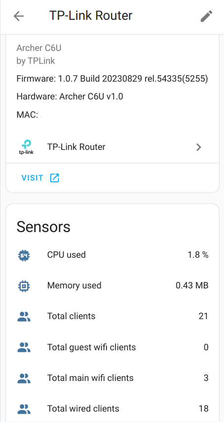
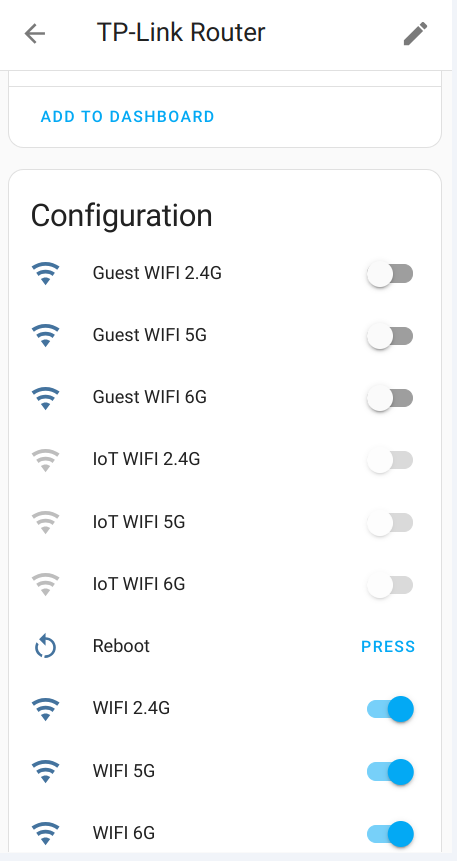
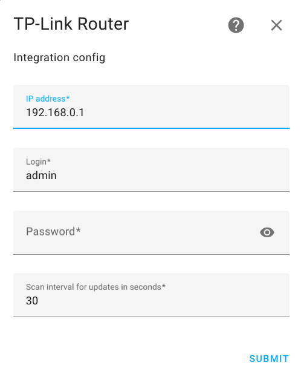
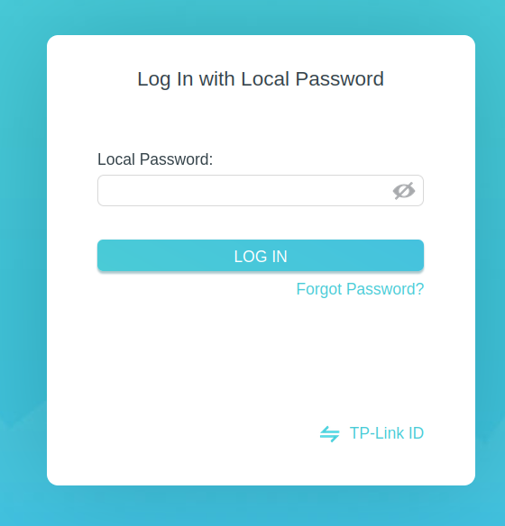

# Tp-Link router integration for Home Assistant (supports also Mercusys router)
[](https://github.com/AlexandrErohin/home-assistant-tplink-router/releases/latest)
[](https://github.com/hacs/integration)
[](https://community.home-assistant.io/t/custom-component-tp-link-router-integration)


Home Assistant component for TP-Link and Mercusys routers administration based on the [TP-Link Router API](https://github.com/AlexandrErohin/TP-Link-Archer-C6U)

> [!WARNING]
> A new router firmware update breaks the compatibility. Please try [this fix](https://github.com/AlexandrErohin/home-assistant-tplink-router/issues/220#issuecomment-3396658175) 

> [!WARNING]
> Please temporarily disable the integration before accessing the router admin page. TP-Link admin page only allows one user at a time. This integration will log you out of the admin page every time it scans for updates (every 30s by default).

See [Supported routers](#supports)

 

## Components
### Events
 - tplink_router_new_device: Fired when a new device appears in your network
 - tplink_router_device_offline: Fired when a device becomes offline
 - tplink_router_device_online: Fired when a device becomes online
 - tplink_router_new_sms: Fired when a new sms received by LTE router
### Buttons
 - Router Reboot

### Switches
 - Router data fetching - you may disable router data fetching before accessing the router, so it wont logging your out.
If you forget to enable it back - it would be automatically enable after the configured `scan_pause` minutes (default 20; set to `0` to keep fetching disabled until you turn the switch on again)
 - 2.4Ghz host wifi Enable/Disable
 - 5Ghz host wifi Enable/Disable
 - 6Ghz host wifi Enable/Disable
 - 2.4Ghz / 5Ghz / 6Ghz host MLO wifi Enable/Disable (EX-family with `mloEnable`; 5G/6G entities are created only when `get_status` reports `wifi_mlo_5g_enable` and `wifi_mlo_6g_enable`)
 - 2.4Ghz guest wifi Enable/Disable
 - 5Ghz guest wifi Enable/Disable
 - 6Ghz guest wifi Enable/Disable
 - 2.4Ghz IoT wifi network Enable/Disable
 - 5Ghz IoT wifi network Enable/Disable
 - 6Ghz IoT wifi network Enable/Disable
 - VPN Client (for some routers)
 - Control VPN Server List (for some routers)
 - LAN IPv4 DHCP Server Enable/Disable (for some routers)
 - E-WAN connect (for MR/EX-family routers with Ethernet WAN) — on = DHCP Renew, off = DHCP Release; useful to reset a stuck WAN link after reboot
 - LED Enable/Disable (for TL-SG family)
 - Per-profile internet access (Archer AX50 HomeCare only; see below)

Wi‑Fi, VPN, DHCP, E-WAN, and LED switches are created only when the device supports them (status field / API method present).

> [!WARNING]
> Disabling the LAN IPv4 DHCP server can leave clients without an IP address (including the Home Assistant host, if it uses DHCP). Prefer static addresses or another DHCP server before turning this switch off.

#### HomeCare parental profiles

Archer AX50 HomeCare profiles are read during the existing router polling cycle,
using the same client, login/logout cycle and request lock. Each profile gets an
internet-access switch: **on** clears its manual pause; **off** manually blocks
internet access. This is **not** effective connectivity: schedules, time limits,
content filters and other router policies still apply when the switch is on.
Profile names may change without changing entity identity. Newly added profiles
are discovered on subsequent polls; removed profiles become unavailable.

Support is initially restricted to AX50 clients using the library's LuCI transport.
Other models (including HomeShield and Deco parental controls) are not probed.
The profile-list API was read on Archer AX50 v1.0 firmware
`1.1.2 Build 20251022 rel.69668(4555)`. The pause/resume endpoint and boolean
encoding come from that firmware's web UI source and have been verified with a
controlled profile pause/resume test. Write acknowledgements without a `data`
field are supported; the resulting pause flag is also read back. Other AX50
firmware may not implement this API. Explicitly
unsupported clients stop profile polling; unknown endpoint errors, malformed
responses and temporary failures make profiles unavailable and retry on the next
poll, without interrupting normal router updates or appearing as an empty list.
Profile filters and browsing insights are not retained as attributes or logged.
Internet-access switches expose `owner_id`, sanitized `assigned_devices` (router
device ID, name, MAC and client type) and the validated current `schedule`.

Profiles with valid non-Pro schedule data also get four configuration switches:
workday/weekend daily-limit enable flags and school-night/weekend bedtime enable
flags. These enable or disable the existing schedule without resetting its times
or budgets. The firmware's `"0"` budget with a disabled flag is an unset-budget
sentinel, not an enabled zero-minute allowance. Its switch remains off; configure
a valid positive budget before enabling it (or set the budget and enable flag
together in the daily-limit action). User-supplied zero-minute budgets are rejected.
Incomplete or HomeCare Pro schedule data is not editable; this does not
hide the profile's manual internet-access switch. Schedule changes and device
assignments are available in the **Network & parental controls** sidebar panel
and as actions in **Developer tools > Actions**. Each action's `profile` field selects the existing **internet-access
switch**, not a schedule switch or Home Assistant device registry ID.

| Action | Settings |
|---|---|
| `tplink_router.get_parental_devices` | Defaults to devices assigned to the selected profile, including offline assignments. Optional `scope: inventory` explicitly returns all router assignment candidates. |
| `tplink_router.assign_parental_device` | Add one router `device_id` to the selected existing profile. Honors the router-reported device limit. |
| `tplink_router.remove_parental_device` | Remove one router `device_id` from that profile, leaving other assignments intact. |
| `tplink_router.set_parental_bedtime` | Set `period` (`workday` or `weekend`), optional `enabled`, optional `begin` and `end` in router-local `HH:MM` (zero seconds). |
| `tplink_router.set_parental_daily_limit` | Set `period`, optional `enabled`, optional `minutes`: **15-960 minutes in 15-minute steps**. This is a daily online-time budget, not an access window. |

Daily-limit `workday` means **Monday-Friday**, and `weekend` means
**Saturday-Sunday**. Bedtime `workday` means **Sunday-Thursday school nights**;
bedtime `weekend` means **Friday-Saturday nights**. Times use the router's local
clock, not Home Assistant timezone conversion. Overnight windows such as
22:00-07:00 are supported. Equal start/end times are rejected because that
firmware's all-day/empty-window semantics have not been established.

Omitted action fields retain their current values; supply at least one setting.
Changing times/budgets does not implicitly enable them. The bedtime action
accepts both ends and the enable flag together to avoid intermediate schedules.
For example (replace the entity ID with your profile's internet-access switch):

```yaml
action: tplink_router.set_parental_bedtime
data:
  profile: switch.example_internet_access
  period: workday
  enabled: true
  begin: "22:00"
  end: "07:00"
```

```yaml
action: tplink_router.set_parental_daily_limit
data:
  profile: switch.example_internet_access
  period: weekend
  minutes: 180
  enabled: true
```

`get_parental_devices` returns `{"devices": [...]}`; each record contains
`device_id`, `name`, `mac`, `client_type` and `owner_id`. Its default
`scope: profile` reads fresh authoritative profile membership and returns only
that profile's devices; an empty profile returns `{"devices": []}`. Removed
profiles and invalid assignment data raise an error instead of returning empty
success. To discover devices to assign, explicitly choose **All router devices
(assignment inventory)** (`scope: inventory`); an empty inventory `owner_id`
means unassigned. Both modes validate that the selected profile still exists.
The response wrapper and device fields are unchanged; automations relying on
the earlier whole-router response must now set `scope: inventory`.

Use `get_parental_devices` with `scope: inventory` to obtain new assignment IDs;
`assigned_devices` also exposes IDs for removal, including offline assignments.
Assigning an already assigned device or removing an absent device is a no-op.
Devices owned by another profile are **not silently moved**: explicitly remove
them there first. This intentionally creates an unassigned interval; do not use
that workflow for live devices without planning the interruption to restrictions.
Profile creation, rename and deletion are available in the admin panel described
below, not as additional automation services. Arbitrary content-filter editing
and Pro/custom-day schedules remain outside this interface.

Every profile edit reads the latest complete record under the shared coordinator
lock, sends the firmware UI's `operation=update` with row `index`, `key`, and JSON
`old`/`new`, and reads the result back. It preserves unrelated names, pause flags,
filters, schedules, device records and unknown fields. Application aliases are
serialized using the router's application metadata without adding the web UI's
default category filters. The native Store's read-only `insights` response field
is excluded from both update records; valid bedtime minute strings are emitted
as JSON numbers, matching the native editor without changing their times.
Missing metadata, invalid assignments or unavailable capacity are explicit errors,
never guessed defaults. This lock serializes this
integration's requests, not independent router clients; avoid concurrent external
edits. Only the firmware's observed empty-object (`{}`) array encoding is
normalized to an empty list; nonempty objects and malformed enabled limits remain
errors.

The native-compatible serializer sends only `client_type`, `name`, `mac`
and string `device_id` for each **new** client-list entry, using stored values for
existing assignments rather than silently refreshing their names from inventory.
The **old** record retains its response metadata. Only the exact observed string
`"0"` daily budget with its enable flag `false` is omitted from the new record;
positive budgets and enabled budgets are never omitted. Raw expected records
remain separate from the wire payload. Readback must retain the disabled sentinel,
filters, schedules, existing names, device identities/types, priorities
(`prio`, `prio_time`, `time_period`) and other existing opaque settings.
Generated per-client `online`/`owner_id` representations do not determine
configured membership; the authoritative list and stable ID/MAC pair do.

**Validation boundary:** the extended assignment/bedtime/daily-limit payloads
were derived from the AX50 firmware's static UI/Store sources and tested with
mocked transport, including the pinned library. Read-only live inspection has
verified the device inventory, capacity metadata, application metadata
(`app_list`, `operation=read`), disabled-budget sentinels and empty-array shapes.
The first extension deployment was rolled back when read-only checks exposed
those schema differences. After restoring the working baseline and removing the
temporary read-only diagnostic, regression-tested corrections were deployed with
fresh approval. Read-only verification confirmed all four schedule switches per
profile, valid device assignments (including empty profiles), the inventory
action and continued polling without new availability failures. An approved
single-device assignment attempt received a successful firmware
acknowledgement but did not persist the requested membership. Readback correctly
reported failure with all existing memberships and protected settings unchanged.
A capture-only native-editor comparison identified additional serialization
differences. The read-only-field/clock encoding compatibility
changes were deployed with a verified current-baseline backup, configuration
check, Core restart and read-only state/polling checks, but a separately approved
single assignment test still did not persist. A subsequent, separately approved
**unmodified native-editor save succeeded**, including for the reported guest
Wi-Fi device. It retained disabled `"0"` budgets, priorities, filters, schedules
and other memberships; one existing client name refreshed from native inventory.
The four-field/disabled-sentinel serializer follows that successful wire
shape without copying the unrelated name refresh. This is evidence for a
serialization correction, not an isolated proof of which wire difference caused
the ignored writes. The integration correction and batch interface were deployed
with a verified current-baseline backup, independently rehearsed rollback,
configuration check and Core restart. Read-only verification confirmed unchanged
memberships/settings, entity availability and panel selection/confirmation
cancellation on desktop and mobile. No integration assignment or batch submission
was included: their write behavior and schedule writes remain hardware-unverified.

Writes are read back under the coordinator lock and request a normal refresh.
They report an error if the write or confirmation fails; a confirmation failure
can mean the router accepted the change but its new state could not be read.
When router data fetching is paused, an explicit switch action still performs its
own write/read-back, but periodic polling remains paused.

The AX50 firmware permits only one admin session. This feature does not change
that limitation: pause router data fetching before using its admin UI and avoid
switch actions while using that UI. Installing this code requires updating the
`custom_components/tplink_router` directory and restarting Home Assistant Core
to load the changed Python modules; existing configuration can be retained.
Keep integration backups outside `custom_components`, since duplicate manifests
can interfere with Home Assistant's integration discovery. Before deploying an
extension, make a fresh checksum-verified backup of the **currently deployed**
integration, preserve any older known-good backups, stage only the intended
integration files, run the Core configuration check, then restart Core after
approval. Verify entity state and normal polling read-only first. Roll back by
restoring that fresh backup and restarting Core. Real assignment/schedule tests
need separate approval for a safe target and an independent, server-side
restoration mechanism; do not rely on browser timers for restoration.

### Network & parental controls workspace

After installing this version and restarting Core, administrators get a
**Network & parental controls** sidebar entry (`/tplink-network`); no dashboard
YAML, custom card, CDN or separate router login is needed. The locally served
native custom panel inherits Home Assistant's theme and supports desktop/mobile.
For multiple router entries, select the router at the top.

The default view is **Online + Wi-Fi (main and guest)**. Search device names,
IP/MAC addresses or friendly profile names; filter state, connection and profile.
Wired, main Wi-Fi, guest Wi-Fi and unknown connections are separate. Current
coordinator device activity determines online status, never a restored tracker's
historical `home` state. Profile-only and historical devices remain available in
All/Offline views, explicitly marked cached when not current. A failed, stale
or paused poll is not presented as live connectivity. The latest poll age is
visible; automatic panel updates read the existing in-memory snapshot every
15 seconds, not the router. **Refresh router** requests the existing coordinator's
normal polling cycle and does not override paused polling.
Incomplete/unavailable membership data is shown as unknown ownership, not
unassigned devices; profile filters and assignment changes are disabled.

Select a device for its supplied name, IP, MAC, connection, band, router-reported
type and available telemetry. No type/vendor guesses are made. Speeds, online
time, signal and traffic usage are labeled **raw router values** because their
units, accumulation window and reset behavior have not been independently
verified for this firmware. Packet counts are counts, not bytes; none of these
values is labeled daily/monthly usage.

**Review profile change** supports assignment, removal and explicit moves between
existing profiles. Confirmation identifies the source and destination and warns
that a move has a briefly unassigned interval, during which restrictions may be
absent. Fresh authoritative membership, device identity, destination capacity and
filter metadata are checked under the existing session lock before removal.
Both steps use full-record edits/readback, preserve unrelated memberships,
filters and schedules, and retain opaque fields on the moved assignment.
There is no atomic firmware move operation. A failed second step first attempts
destination cleanup, then restoration of the original assignment. If recovery
cannot be confirmed, the interface reports failure and refreshes the actual
state; it never silently retries or assumes protection was restored. Inspect
both profiles in that case before another action.

**Assign selected devices** adds multiple **currently unassigned** devices to one
existing profile. Check individual device boxes or **Select visible unassigned**;
the latter only adds the currently filtered candidates. Selection survives search
and quiet refreshes, with a count of selected devices hidden by filters. Clear the
selection explicitly when needed. Cached devices and devices already owned by a
profile cannot be batch-selected: use their individual **Review profile change**
flow for explicit moves or removal. This batch action does not authorize either.

Choose a destination and review its name, count and the selected device names
before confirmation. The new admin-only panel action rechecks fresh memberships,
unique identities and the router's remaining capacity for the **whole** selection
under the incumbent lock. The request is limited to 32 devices, with the smaller
router-reported capacity still enforced. Invalid/stale ownership, ambiguous or
missing inventory entries and insufficient capacity reject the entire preflight
without a write. One full-profile update is submitted, not one update per device.
This is not a guarantee of transactional firmware behavior.

Results are displayed per device: confirmed assigned, assigned with unconfirmed
protected settings/acknowledgement, not assigned, conflicting ownership/identity,
or unknown. A partial application or lost response never becomes blanket success.
The submitted selection clears, the error/results remain visible across quiet
reads, and no retry, automatic cross-profile move or compensating removal occurs.
Inspect actual memberships and protected settings before another action.
The batch interface is deployed; no live batch assignment test has been made.

A read-back mismatch is not proof of success or of a guest-network restriction.
Assignment errors distinguish a missing destination assignment, an applied
assignment with differing protected settings/details, and a removal that did not
persist. Verification remains strict. Mismatch logs contain only fixed field
labels/types, client counts and requested-identity presence booleans, never
device IDs, MAC/IP addresses, names, browsing/filter values or raw profiles.
These diagnostics do not retry an edit; a controlled hardware retry requires
separate approval.

The **Parental profiles** tab shows current membership, manual internet-access
pause and usable forms for bedtime windows and daily budgets, including their
enable flags. Forms state the actual night/day groups and router-local units.
Unsaved drafts survive background snapshot updates. Stale/unavailable data
disables panel writes; the backend independently validates every edit.

The new panel's reads and writes require an **authenticated, active Home Assistant
administrator**, enforced by its websocket handlers as well as the sidebar.
Existing parental actions and switches retain Home Assistant's standard
admin-service context semantics: trusted internal/system calls and automations
without a user ID continue to work; calls carrying a user ID must resolve to an
active administrator. Unknown, inactive and non-admin direct users are rejected.
No administrator identity is fabricated for an automation, and a call carrying a
non-admin user ID does not gain access merely by having an automation parent
context. Other router controls are unchanged. Router credentials and session
tokens never enter the frontend.

**Staged profile management:** the **Create new profile** button loads the router's
`patrol_limit` capacity and `patrol_filter` presets on request. Enter a name of
1–64 UTF-16 code units, choose a preset and review its blocked-category identifiers.
The categories are the native editor's union of its selected `prefilter_list`
and mandatory `categories_list`; unavailable/malformed metadata has no fallback.
Capacity and the exact reviewed preset are checked again under the shared lock.
The native `operation=insert&index=0&key=add&old=add` creates an **empty** profile.
No device is assigned or moved implicitly; use the existing assignment workflow
after creation is confirmed. Native initial values are explicit: no custom
websites/apps, manual pause cleared, daily limits disabled with stored 120-minute
values, and bedtime disabled with stored 22:00–07:00 router-local windows.

**Review rename** retains the owner ID, memberships, filters, schedules,
priorities and unknown fields. It rejects a stale original name or a conflicting
name; entity IDs are not renamed. **Review delete profile** first loads a fresh
profile name and affected-device list. Confirmation warns that all its filters,
budgets and schedules are removed and its devices lose that profile's protection.
A revision of all protected fields prevents deleting a changed profile from a
stale confirmation; generated online/owner metadata does not invalidate it.
Native Store `operation=remove` sends the one fresh row key/index, not a sequence
of device removals. Other profiles are read back and checked unchanged.
Deleted-profile entity registry entries are not silently erased; their entities
become unavailable, preserving user customizations and automation references.
All management writes use one application-level submission, explicit
acknowledgement plus strict readback, and no automatic retry, deletion,
recreation or other compensating mutation on ambiguous results.

**Staged private reporting:** select a profile (or one of its devices) and click
**Load profile report**. The two native read-only endpoints,
`patrol_insights` and `patrol_insights_history`, use `operation=read&owner_id=...`
under the incumbent authentication/request lock. They are never added to routine
polling. Native UI decoding establishes `spend_online` as **minutes** and
`access_timestamp` as Unix **seconds**, with period 0 today through period 6 six
days ago. The view shows only returned periods, website labels, online minutes,
timestamped history and the router's block flag. History times use the browser's
local time zone; no unverified router-date conversion is invented.
Partial endpoint/schema errors remain explicit beside successful sections.
An empty successful response is distinct from unsupported or failed reads.

These are **profile-wide router observations**, not per-device attribution,
full-URL/person-level browsing proof or byte-usage totals. Encryption and router
coverage can leave records incomplete; actual retention/reset boundaries remain
unverified. Raw device traffic counters still carry their earlier unit/period
warning. Report snapshots are not automatically refreshed. **Clear private
report**, leaving details, changing router, hiding the page or disconnecting the
panel removes the transient report; late navigation responses are discarded.
Report contents are never stored in coordinator/entity state, Recorder,
local/session storage, ordinary logs, artifacts or external services. Site labels
are escaped text, never executable markup or outgoing links.

Creation/rename/deletion and reporting are **deployed and synthetically
validated, but their write/report operations are not hardware-verified**. The
deployed forms, capacity/filter metadata read, confirmation and cancellation
flows, admin gating, registration, and polling were checked without submitting
profile changes or loading reports. No live report was retrieved. Different
firmware response shapes fail visibly rather than masquerading as empty reports
or successful writes. The router's single-admin-session limitation still
applies; these features do not add another router client.

**Validation and deployment boundary:** the workspace and compensating move
workflow have synthetic backend/frontend regression coverage, including admin
denial, preservation, failed acknowledgements, cleanup/restoration failures,
filtering, confirmation, drafts, errors and stale data. The native registration
API is exercised on Home Assistant 2026.10.4 with `tplinkrouterc6u==5.38.0`;
desktop/mobile interaction checks use a synthetic fixture. Read-only deployment
checks also verified the installed admin panel at desktop/mobile sizes, current
profile membership, unchanged existing parental states and continued polling.
The native-editor assignment success above does not validate the corrected
integration serializer, batch feature, moves, bedtime or budget writes.
The profile management/reporting extension was deployed after fresh approval;
profile writes and report reads still require a separately defined
hardware-verification scope. Each deployment needs fresh approval, a
checksum-verified backup of the current integration outside
`custom_components`, an independently rehearsed rollback, the changed Python
files/manifest plus `frontend/network-panel.js`, a Core configuration check and
restart. Preserve earlier backups and verify existing entities, availability,
normal polling and read-only views before considering any separately approved
hardware-write test.

Developer checks: `.venv\Scripts\python.exe -m pytest tests -q` and
`node --test tests\frontend\network-panel.test.mjs`. For browser interaction checks,
serve the repository on loopback and open `tests/frontend/network-fixture.html`;
call each iframe's `runTests()` from browser tools. Both frames are fully
synthetic and make no router/Home Assistant requests.

### Sensors
Status sensors (client counts, CPU/memory, WAN/LAN addresses, …) are created only when the device reports a non-`None` value for that metric:
 - Total amount of wired clients
 - Total amount of IoT clients
 - Total amount of host wifi clients
 - Total amount of guest wifi clients
 - Total amount of all connected clients
 - CPU used
 - Memory used
 - Connection Type
 - WAN Uptime (Internet connection duration in seconds; useful to detect WAN reconnects)
 - WAN IPv4 Address
 - LAN IPv4 Address
 - DHCP Reservations (count; full lease list in attributes — on routers with `get_ipv4_reservations`, when enabled in options)
 - Mesh node backhaul (Deco / EasyMesh with backhaul metrics): signal 2.4/5 GHz, RX/TX rate 2.4/5 GHz, internet status — one diagnostic sensor per reported metric, on the mesh node device from the tracker platform (only when device tracking is enabled)

For LTE Routers
- LTE Enabled
- LTE Connection Status
- LTE Network Type
- LTE SIM Status
- LTE Total Statistics
- LTE Current RX Speed
- LTE Current TX Speed
- Unread SMS
- LTE Signal Level
- LTE RSRP
- LTE RSRQ
- LTE SNR
- LTE ISP Name

### Binary Sensors
For devices with `get_port_status` (e.g. TL-SG108E, Archer C5400X):
 - Per-port connectivity (link up/down)

### Port Sensors
For devices with `get_port_status` (e.g. TL-SG108E, Archer C5400X):
 - Per-port negotiated link speed (Mbps). Switch ports (`PortStatus`, e.g. TL-SG108E) keep attributes for duplex, enabled, auto-negotiation, configured speed/duplex, flow control, LAG and TX/RX packet counters; router ports (`RouterPortStatus`, e.g. Archer C5400X) expose `negotiated_duplex` only

### Device Tracker
 - Track connected to router devices by MAC address with connection information
 - On EasyMesh networks, one tracker per mesh node (the main router included), carrying the node's model, role, uplink type, client count and the MAC of the node it uplinks through

Mesh node trackers appear only when the router reports an EasyMesh (or Deco mesh) network and the installed `tplinkrouterc6u` exposes `get_mesh_nodes`; otherwise nothing is created and nothing is logged. Their attributes reuse the names `ha-tplink-deco` publishes (`device_type`, `device_model`, `connection_type`), so a dashboard or card written for one works for the other. The uplink quality is published as `signal_level`, a 1 to 3 bar level, rather than as `signal`, which for clients is a dBm value.

On Deco meshes that report per-band backhaul, diagnostic sensors are added to each satellite (and internet status to any node that reports it) for signal and RX/TX rates on 2.4/5 GHz. A sensor is created only after that node reports the metric, so EasyMesh nodes and the main router's empty backhaul fields do not produce always-`unknown` entities. These sensors share the mesh node devices created by the trackers and are skipped when device tracking is disabled in the integration options.

When using multiple routers (for example, a WAN router and a separate access point), you can disable device trackers for the non-AP router in the integration options to avoid duplicate device entries.

`offline_timeout` (seconds, default `0`) keeps a device marked home for a grace period after it disappears from the router's client list, which reduces false "not home" flips for phones that briefly drop Wi‑Fi to save battery. `0` means mark offline immediately (previous behavior). The grace period applies only when the MAC leaves the client list; if the router still lists the device with `active=false`, it is marked offline immediately.

To find your device - Go to `Developer tools` and search for your MAC address - you’ll find sensor like `device_tracker.YOUR_MAC` or `device_tracker.YOUR_PHONE_NAME`.

Each tracked client gets a device entry linked by MAC (so it can merge with devices from other integrations). Enable "Nest each tracked client under the router device" in the integration options if you also want those client devices nested under the router via `via_device_id`; it's off by default. Turning the option off later does not delete already-created device-registry entries — remove them manually in Devices if you no longer want them.

It will also fire Home Assistant event when a device connects to router

### Services
 - Send SMS message - Available only for MR LTE routers
 - Add DHCP Reservation (`tplink_router.add_reservation`) — available on c6u-family routers that implement `add_ipv4_reservation` (when enabled in options)
 - Delete DHCP Reservation (`tplink_router.delete_reservation`) — same routers with `delete_ipv4_reservation`

Many router models expose a read-only DHCP reservations sensor via `get_ipv4_reservations` even when add/delete actions are not supported. Disable "Include DHCP reservations..." in the integration options to skip polling and hide the sensor/services.
### Notification
#### Device events
To receive notifications of appearing a new device in your network, or becoming device online\offline add following lines to your `configuration.yaml` file:
```yaml
automation:
  - alias: "New network device"
    trigger:
      platform: event
      event_type: tplink_router_new_device
    action:
      service: notify.mobile_app_<device_name>
      data:
        content: >-
          New device appear {{ trigger.event.data.hostname }} with IP {{ trigger.event.data.ip_address }}
```
Available events:
 - tplink_router_new_device: Fired when a new device appears in your network
 - tplink_router_device_offline: Fired when a device becomes offline
 - tplink_router_device_online: Fired when a device becomes online

All available fields in `trigger.event.data`:
- hostname
- ip_address
- mac_address
- connection
- band
- packets_sent
- packets_received
- up_speed
- down_speed
- tx_rate
- rx_rate
- online_time
- traffic_usage
- signal

#### SMS events only for MR LTE routers
To receive notifications of receiving a new sms add following lines to your `configuration.yaml` file:
```yaml
automation:
  - alias: "New sms"
    trigger:
      platform: event
      event_type: tplink_router_new_sms
    action:
      service: notify.mobile_app_<device_name>
      data:
        content: >-
          A new SMS from {{ trigger.event.data.sender }} wth text: {{ trigger.event.data.content }}
```
Available events:
 - tplink_router_new_sms: Fired when a new sms received by LTE router

All available fields in `trigger.event.data`:
- sender
- content
- received_at

### Send SMS only for MR LTE routers
To send SMS add following lines to your automation in yaml:
```yaml
...
action:
  - service: tplink_router.send_sms
    data:
      number: "+1234567890"
      text: "Hello World"
      device: pass_tplink_router_device_id_here
```

Device id is required because user may have several routers that could send SMS - so you need to select the needed router.
You can get the ID from the URL when you visit the tplink device page

## Installation

### HACS (recommended)

Have [HACS](https://hacs.xyz/) installed, this will allow you to update easily.

<a href="https://my.home-assistant.io/redirect/hacs_repository/?owner=AlexandrErohin&repository=home-assistant-tplink-router&category=integration" target="_blank"></a>

or go to <b>Hacs</b> and search for `TP-Link Router`.

### Manual

1. Locate the `custom_components` directory in your Home Assistant configuration directory. It may need to be created.
2. Copy the `custom_components/tplink_router` directory into the `custom_components` directory.
3. Restart Home Assistant.

## Configuration
TP-Link Router is configured via the GUI. See [the HA docs](https://www.home-assistant.io/getting-started/integration/) for more details.

The default data is preset already.



1. Go to the <b>Settings</b>-><b>Devices & services</b>.
2. Click on `+ ADD INTEGRATION`, search for `TP-Link Router`.
3. Fill Login (default `admin`; some routers use `user`) and Password.
4. Click `SUBMIT`

If you got an error please try to use HTTPS connection first

NOTE!
1. If you use `https` connection - for most routers turn on "Local Management via HTTPS" (advanced->system->administration). Some models (e.g. Archer NX200) already accept local HTTPS without enabling Remote Management via HTTPS.
2. If you use `https` connection to your router you may get error `certificate verify failed: EE certificate key too weak`. To fix this - unset `Verify ssl`
3. Use Local Password which is for Log In with Local Password. Login with TP-LINK ID doesnt work



4. If you got error - `check if the default router username is correct` The default username for most routers is `admin`. Some routers (e.g. Archer NX200) use `user` instead — try Login `user` with your normal Local Password.
5. If you got error - `use web encrypted password instead` Read [web encrypted password](#encrypted_pass)
6. The TP-Link Web Interface only supports upto 1 user logged in at a time (for security reasons, apparently). So you will be logged out from router web interface when the integration updates data

### Archer NX200 (and similar EX / 5G routers)
If setup fails with HTML/welcome-page responses or login errors while the router is reachable:

1. Host: `https://192.168.x.1` (not `http://`)
2. Login: `user` (not `admin`)
3. Password: normal Local Password (web encrypted password is not needed)
4. Verify SSL: off

Remote Management via HTTPS can stay off — local HTTPS access is enough.

### <a id="encrypted_pass">Web Encrypted Password</a>
If you got error - `use web encrypted password instead. Check the documentation!`
1. Go to the login page of your router. (default: 192.168.0.1).
2. Type in the password you use to login into the password field.
3. Click somewhere else on the page so that the password field is not selected anymore.
4. Open the JavaScript console of your browser (usually by pressing F12 and then clicking on "Console").
5. Type `document.getElementById("login-password").value;`
6. Copy the returned value as password and use it.

### Edit Configuration
You may edit configuration data like:
1. Router url
2. Password
3. Scan interval
4. Scan retries (1–10; default 3) — how many times a failed data poll is retried
5. Scan backoff (0.1–30s; default 1.0) — delay between retries, grows with each attempt
6. Scan pause (0–1440 minutes; default 20) — how long "Router data fetching" stays off before auto re-enable (`0` = never auto re-enable)
7. Offline timeout (0–86400 seconds; default 0) — grace period before a missing device tracker goes offline
8. Verify https
9. Include support for VPN server/client (enable/disable VPN status polling and related VPN entities)
10. Include device trackers (disable for non-AP routers to avoid duplicate entries)
11. Nest each tracked client under the router device (off by default; clients always get a MAC-linked device; disabling later does not remove already-created device cards)
12. Include DHCP reservations sensor and add/delete services (default on)
13. Include LTE serving cells sensors (default on; disable to skip probing/polling on routers without this feature)

Transient poll failures (timeouts, dropped connections, session expiry) are retried automatically. Authorization failures (wrong password / HTTP 401) are not retried. A failing SMS mailbox fetch does not fail the whole update.
An unreachable router during setup fails only that config entry (`Failed to set up`) and does not block other TP-Link Router entries.

To do that:

1. Go to the <b>Settings</b>-><b>Devices & services</b>.
2. Search for `TP-Link Router`, and click on it.
3. Click on `CONFIGURE`
4. Edit the options you need and click `SUBMIT`

## <a id="supports">Supported routers</a>
- [TP-LINK routers](#tplink)
- [MERCUSYS routers](#mercusys)
### <a id="tplink">TP-LINK routers</a>
- Archer A10 v1
- Archer A20 v1.0
- Archer A6 (2.0, 4.0)
- Archer A7 V5
- Archer A8 (1.0, 2.20)
- Archer A9 V6
- Archer AX10 v1.0
- Archer AX11000 V1
- Archer AX12 v1.0
- Archer AX17 v1.0
- Archer AX1800 v1.20
- Archer AX20 (v1.0, v3.0)
- Archer AX21 (v1.20, v3.0, v4.6)
- Archer AX23 (v1.0, v1.2)
- Archer AX3000 V1
- Archer AX50 v1.0
- Archer AX53 (v1.0, v2)
- Archer AX55 (v1.0, V1.60, v4.0)
- Archer AX55 Pro v1.0
- Archer AX58 v1.0
- Archer AX6000 V1
- Archer AX72 V1
- Archer AX73 (V1, V2.0)
- Archer AX75 V1
- Archer AX90 V1.20
- Archer AX95 v1.0
- Archer AXE16000
- Archer AXE5400 v1.0
- Archer AXE75 V1
- Archer BE220 v1.0
- Archer BE230 (v1.0, v2.0)
- Archer BE3600 (v1.0, v1.2, v1.6)
- Archer BE400 v1.0
- Archer BE450 v1.0
- Archer BE550 (v1.0, V2)
- Archer BE600 v1.0
- Archer BE800 v1.0
- Archer BE805 (v1.0, v1.20)
- Archer C1200 (v1.0, v2.0)
- Archer C2300 (v1.0, v2.0)
- Archer C24 (1.0, 2.0)
- Archer C3200 v1
- Archer C5400X V1
- Archer C6 (v2.0, v3.0, v3.20, 4.0)
- Archer C50 v4
- Archer C60 v2.0
- Archer C64 1.0
- Archer C6U v1.0
- Archer C7 (v4.0, v5.0)
- Archer C80 (1.0, 2.20)
- Archer GE800 v1.0
- Archer GX90 v1.0
- Archer MR200 (v2, v5, v5.3, v6.0)
- Archer MR400 V.4.3
- Archer MR550 v1
- Archer MR600 (v1, v2, v3)
- Archer NX200 (v1.0, v2.0)
- Archer VR1200v (v1, v2)
- Archer VR1600v v1
- Archer VR2100v v1
- Archer VR2800 v1
- Archer VR400 (v2, v3)
- Archer VR600 v3
- Archer VR900v
- Archer VX1800v v1.0
- Archer VX231v v1.0
- BE11000 2.0
- CPE210 v2.0
- CPE220 v3.0
- Deco BE25 1.0
- Deco E4R 4.0
- Deco M4 2.0
- Deco M4R 2.0
- Deco M5 v3
- Deco M9 Plus 1.0
- Deco M9 Pro
- Deco P7
- Deco X20
- Deco X50 v1.3
- Deco X50-5G (1.20, 2.0)
- Deco X55 1.0
- Deco X60 V3
- Deco X90
- Deco XE75 (v1.0, v2.0)
- Deco XE75PRO (v3.0)
- EAP115 v2.0
- EX220-G2u v1
- EX511 v2.0
- EX920 v1.0
- HB810 v2.6
- HX510 v1.0
- M8550 v1
- NE200-Outdoor v1.0
- NE211-Outdoor v1.0
- NX510v v1.0
- NX600 v2.0
- RE305 4.0
- RE315 1.0
- RE330 v1
- RE505X v1.0
- RE700X
- RE705X v1.0
- RE813XE v1.6
- TD-W9960 (v1, V1.20)
- TL-7DR6430 1.0
- TL-7DR7270 1.0 (firmware 1.0.18+, new auth)
- TL-MR100 (v2.0, v3.0)
- TL-MR100-Outdoor v1.0
- TL-MR105
- TL-MR110-Outdoor v1.0
- TL-MR150 v2
- TL-MR6400 (v5, v5.3, v7)
- TL-MR6500v
- TL-R470GP-AC (4.0, 6.0)
- TL-R488GPM-AC 2.0
- TL-SG108E v6.0
- TL-WA1201 3.0
- TL-WA3001 v1.0
- TL-WR841N v14
- TL-WR844N v1.0
- TL-WR3002X v1.0
- TL-WDR3600 V1
- TL-WDR7660 3.0.10
- TL-XDR3010 V2
- TL-XDR5410 1.0
- TL-XDR6010
- TL-XDR6088 v1.0.30
- VX420-G2h v1.1
- VX800v v1
- XC220-G3v v2.30
- XGB834v v1.1
### <a id="mercusys">MERCUSYS routers</a>
- AC10 1.20
- Halo H25BE 1.0
- Halo H3000x 1.0
- Halo H47BE 2.0
- Halo H60XR 1.0
- Halo H80X 1.0
- MB118-4G v1.0
- ME30 1.0
- MR47BE v1.0
- MR50G 1.0
- MR60X 2.0
- MR80X v2.0

Please let me know if you have tested integration with any other model. Open an issue with info about router's model, hardware and firmware versions.

## <a id="add_support">Adding Support For More Models</a>
Guidelines [CONTRIBUTING.md](https://github.com/AlexandrErohin/TP-Link-Archer-C6U/blob/master/CONTRIBUTING.md)
